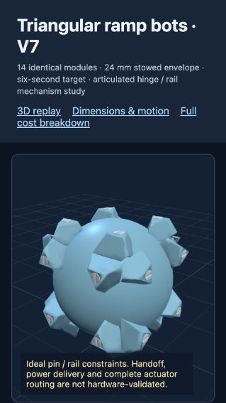
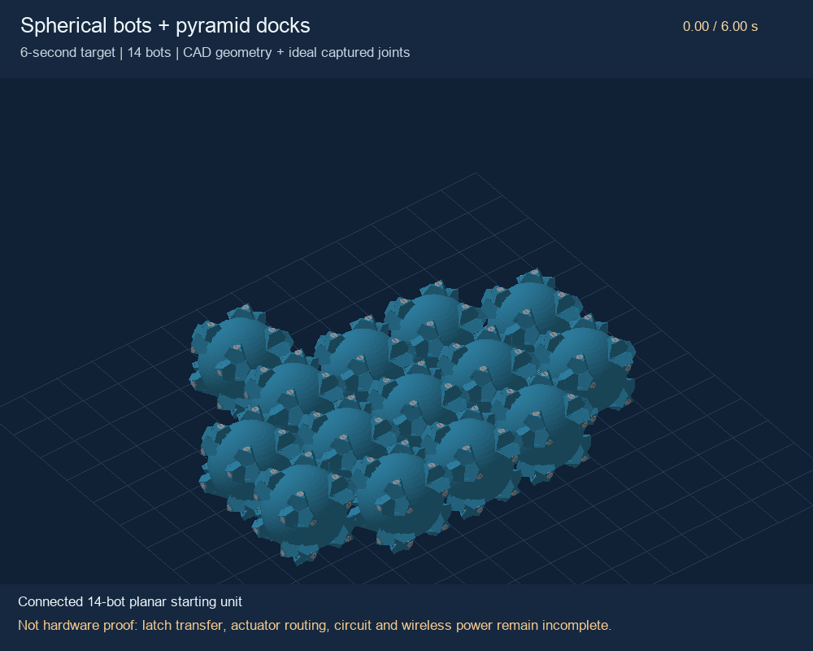

# Microbot

Editable CAD, simulation, electronics packaging and cost studies for a **24 mm, hub-free, externally powered modular robot swarm**. Current design: **V7 triangular ramp docks**, 14 bots assembling into a 9 + 4 + 1 pyramid.

**Status: engineering candidate. The six-second animation works; a functioning hardware swarm has not been built or validated.** The drive transmission, automated latch transfer, routed circuit board and elevated wireless-power delivery remain incomplete. Costs are unquoted allowances; the $47.67 custom-drive target has not been achieved.



## Start here

- [Current design and validation state](docs/PROJECT_STATE.md)
- [Full design files, simulator and numerical outputs](designs/v7)
- [235-piece material BOM](designs/v7/BOM.csv) and [component dimensions](designs/v7/Piece_dimensions.csv)
- [Cost inputs and target budgets](designs/v7/cost_v7.json), [current cost CSV](designs/v7/Cost_10000.csv), [future cost caps](designs/v7/CostDown_Target.csv)
- [FreeCAD bot](designs/v7/Bot24.FCStd), [STEP export](designs/v7/Bot24.step), [14-bot assembly](designs/v7/Swarm14.FCStd)
- [Board placement drawing](designs/v7/BoardLayout.svg), [package placement](designs/v7/board_placement.csv), [electrical screening](designs/v7/electrical_check.json)
- [Six-second MP4](designs/v7/SixSecondAssembly.mp4)

## Run the interactive viewer

Clone or download this repository. From its root, run:

```sh
python3 -m http.server 8771 --bind 127.0.0.1
```

Open **http://127.0.0.1:8771/designs/v7/RefinedBots.html** in a browser with WebGL2 support. Opening the HTML directly with `file://` will not load its JSON assets. The viewer includes dimensions, materials, motion/torque calculations, circuit status, every modeled component and full cost tables. Three.js is bundled locally; the viewer does not need a CDN.



## Rebuild and collaborate

See [rebuilding instructions](docs/REBUILD.md) and [contribution guidelines](CONTRIBUTING.md). Python 3.10+, NumPy, Pillow, FreeCAD, Node.js and FFmpeg cover the build and verification tools. Prebuilt CAD and media are included so you can review without installing them all.

Anyone can propose changes through issues and pull requests. Direct push access requires the owner to invite named collaborators in repository settings. No collaborators are automatically granted access by these files.

Original project licensing has not yet been selected; public visibility alone does not grant a general reuse license. The bundled Three.js library retains its [MIT license](designs/v7/vendor/LICENSE).
